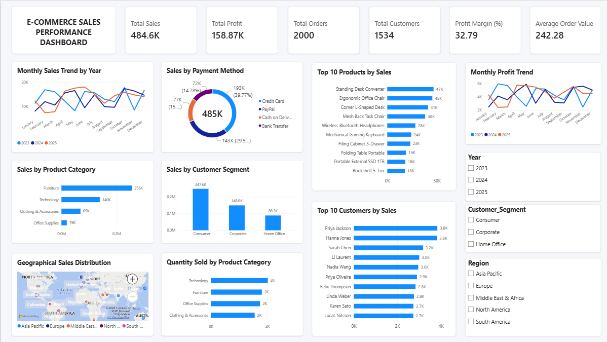

# E-Commerce Sales Analysis

End-to-end data analytics project on global e-commerce orders, using Python, SQL and Power BI to find what drives sales and profit.

## Project Overview

This project analyzes 2,000 orders (Jan 2023 to Dec 2025) from 1,534 customers across 20 countries and 5 regions. It covers data cleaning, exploratory analysis in Python, business queries in SQL, and an interactive Power BI dashboard.

## Objectives

- Measure overall sales and profit performance.
- Identify top-performing products, categories and regions.
- Understand customer segments and payment behaviour.
- Study the impact of discounts on profitability.
- Build an interactive dashboard for business users.

## Tools & Technologies

- **Python** (Pandas, Matplotlib): cleaning, EDA, visualization
- **SQL**: business analysis queries
- **Power BI**: data modeling (star schema), DAX measures, dashboard
- **Excel / CSV**: data handling

## Dataset

File: `01_Dataset/global_ecommerce_sales.csv` (2,000 rows, 15 columns)

Columns: Order_ID, Order_Date, Customer_Name, Customer_Segment, Country, Region, Product_Category, Product_Name, Quantity, Unit_Price, Discount_Percent, Total_Sales, Shipping_Cost, Profit, Payment_Method

Data quality: no missing values and no duplicate rows.

## Key Metrics

| Metric              | Value    |
| ------------------- | -------- |
| Total Sales         | $484.56K |
| Total Profit        | $158.87K |
| Profit Margin       | 32.79%   |
| Total Orders        | 2,000    |
| Total Customers     | 1,534    |
| Average Order Value | $242.28  |

## Key Insights

1. **Furniture drives the business.** It contributes 52.9% of total sales ($256K) and the most profit ($81K).
2. **Office Supplies is low value.** It brings only 4% of sales, with the lowest margin (17.1%) versus 37.6% for Clothing & Accessories.
3. **Europe and North America lead.** Together they generate about 56% of sales (28.3% and 27.6%). South America and Middle East & Africa contribute about 9.5% each, which shows room for growth.
4. **Consumer is the biggest segment** with 52.9% of sales and the best margin (34.1%). Corporate has the lowest margin (30.4%).
5. **Credit Card is the most used payment method** (39.8% of sales), followed by PayPal (29.5%).
6. **Discounts reduce profitability.** Profit margin falls from 38.7% on undiscounted orders to 25.5% at 11-20% discount and 17.6% above 20%.
7. **Sales are fairly stable year to year.** 2025 sales ($165K) were 6.3% higher than 2024 ($155K), after a dip in 2024. October is the strongest month overall.
8. **Top profit products:** Ergonomic Office Chair ($15.1K), Standing Desk Converter ($14.7K) and Corner L-Shaped Desk ($13.7K).

## Recommendations

- Focus marketing and inventory on Furniture and Technology.
- Review heavy discounts above 20%, since margin drops sharply.
- Expand in South America and Middle East & Africa through targeted campaigns.
- Review pricing or bundling for Office Supplies to improve margin.

## Dashboard

The Power BI dashboard includes KPI cards, monthly sales trend, sales by category, segment, payment method, region and country, and top customers and products. Slicers for Year, Region and Customer Segment make it interactive.

Open `04_PowerBI_Dashboard/E_Com.pbix` with Power BI Desktop.

## Project Structure

    01_Dataset/            Raw dataset (CSV)
    02_Python_Analysis/    Python EDA notebook
    03_SQL_Analysis/       SQL analysis notebook
    04_PowerBI_Dashboard/  Power BI file (.pbix)
    05_Reports/            Project report (DOCX, PDF)
    images/                Dashboard screenshots

## How to Run

1. Clone this repository.
2. Open the Python notebook in Jupyter and run all cells (needs pandas and matplotlib).
3. Open the .pbix file in Power BI Desktop to explore the dashboard.

## Author

**Purushothaman S.**
[GitHub](https://github.com/PurushothamanS712)
